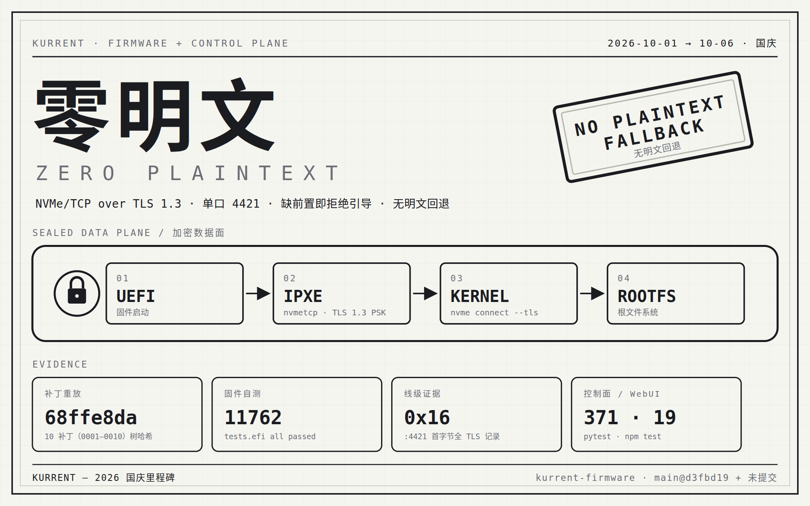

# 里程碑（MILESTONE）

> 本文件记录项目的重要达成节点（非逐条变更；逐条变更见 `patches/`、各仓库 CHANGELOG）。
> 每个节点须附**可验证证据**，不接受“应该没问题”。

---

## 2026-10（国庆假期）：NVMe/TCP 全链路零明文

> 2026-10-01 ~ 10-06 ｜ 状态：**已完成并端到端验收**（固件段 + 内核段均已实测）

> 海报为手绘 SVG（`docs/assets/milestone-2026-10.svg`，可直接编辑）；上方 PNG 为其定尺寸渲染，纯黑白工业风、等宽字体，与项目设计系统一致。

Kurrent 的引导数据面，从“只认证、全程明文”走到“固件段与内核段共用同一个端口、全程 TLS 1.3、缺前置即拒绝引导、无明文回退”。

### 起点 → 终点

| 维度 | 起点（假期前） | 终点（假期后） |
|---|---|---|
| 认证 | DH-HMAC-CHAP（只回答“谁能连”） | 不变——认证与加密是**彼此独立的两层** |
| 数据面 | 全程明文 NVMe/TCP | **TLS 1.3（PSK）**，单口 |
| 固件段 | 明文 | 固件**自带** TLS 1.3 PSK 客户端（iPXE 上游栈只到 1.2） |
| 内核段 | 明文 | `nvme connect --tls` |
| 密钥 | 认证密钥 | 认证密钥 **+ 由它派生的 PSK**（纯函数，无新增存储字段） |
| 缺前置 | 回落明文 | **拒绝引导**并记审计 |
| 数据面端口 | `4420` 明文 + `4421` TLS（双口） | **`4421` 单口**（固件段与内核段共用） |

### 打了哪几仗

1. **内核段 TLS（段 1）**——目标端 nvmet 单开 `tsas=tls1.3` 口、PSK 注入内核全局 `.nvme` keyring、initramfs 消费 NBCT 的 TLS 字段后以 `--tls` 重连；冷启动到 `login:` 验收通过。
2. **固件段 TLS 1.3 PSK 客户端（段 2.1 / 2.2）**——在 iPXE 里从零实现 RFC 8446 的密钥调度 / ClientHello + PSK binder / ServerHello 解析 / X25519 密钥交换 / Finished / 记录层 AEAD，外加驱动握手的过滤连接层，并把它接进 `nvmetcp`。
3. **端口收口（段 2.3）**——撤掉明文口 `4420`。**关键认知：端口号与“是否加密”无关**（`addr_tsas` 才是），撤的不是“明文能力”而是“第二个端口”——它唯一的存在理由（固件还不会 TLS）在段 2 完成后就消失了。
4. **控制面 enforcement（段 2.4）**——“有密钥 + 数据面端口就绪”缺任一即**整体不下发 `/boot-vars`**（= 拒绝引导）并记审计，而不是静默回退明文。
5. **WebUI 加密姿态视图（段 2.5）**——把“这台 Worker 会不会因为加密前置不满足而启不来”变成运维一眼可见并可**归因**（无密钥 / 端口未就绪），并修正“吊销后回落明文”的过时文案。

### 可验证的成果（证据表）

| 面 | 证据 |
|---|---|
| 固件补丁 | 10 补丁（`0001`–`0010`），重放树哈希 `68ffe8da6614a79999980dcf6162fc4d5976b8ec`（2026-10-16 加入设备 NVRAM 清理后重算）；`reference/` 29 文件与工作树逐字节 0 差异 |
| 固件自测 | `tests.efi` 串口：`tls13` 110 / `tls13conn` 27 / `nvmetcp` 101，合计 `all 11762 tests passed` |
| 固件段线级 | 对真实 nvmet TLS 目标 2 次 `handshake complete` + 注册 SAN 读盘；`:4421` 客户端流首字节全 `0x16`、明文 ICReq 计数 0 |
| 内核段冷启动 | VM 到 `login:`；pcap `:4421` 流首字节 `0x16`、零明文；宿主 `TlsTxSw=TlsRxSw` 非零、无 `TlsDecryptError`；目标端 dmesg `, TLS.` |
| 控制面/主仓 | `pytest tests` **371 passed** |
| WebUI | `npm test` 19 passed（含 8 例新测）+ `npm run build` 通过；浏览器四场景实测（加密生效 / 拒绝引导·无认证密钥 / 恢复 / EN 文案）；判定纯函数经**变异验证**（改掉 oracle 对应用例必红） |

### 最难忘的三个点

1. **在只有 TLS 1.2 的栈上写 1.3**——上游 iPXE 的 TLS 栈到 1.2 为止。1.3 的 PSK 模式砍掉了证书半边，但密钥调度、binder、EDHOC 式的 transcript 与记录层全都得自己来，验收只能靠 RFC 8448 官方向量对拍。
2. **一个只在“复跑”时才现形的竞态死锁**——`tls13_psk_tx()` 在“已进入 DATA 且无待发记录”时走了 `default: return`，恰好跳过了“通知明文窗口变化”；而 iPXE 的 TCP 在有未确认段时报零窗口，这个通知就再也不会补发，消费者永久停摆。首跑绿、复跑红。修复后**补了连接层单测做回归，并用变异测试证明它不是空转**。
3. **“零明文”的收口不是加密，而是删端口**——所有人第一反应都是“把 4420 也加密”。真正的收口是意识到 4420 存在的唯一理由是“固件还不会 TLS”，于是撤掉它——只留一个强制 TLS 的口，才是真的没有降级入口。

### 还没做 / 下一步

- 上线顺序仍要守：**固件先上**（端口匹配判据 ⇒ 行为零变化），再把控制面端口切到 `4421`；反了会让旧固件对 `treq=required` 的口发明文 ICReq 而启动失败。
- 引导链仍有明文残留（**PXE 固有**）：DHCP + TFTP 搬运引导器与两个指针脚本；元数据面走 HTTPS+TOFU，首启无信任锚。这两件在 NVMe-oF 数据面之外，另立项。
